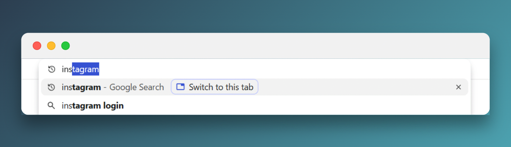
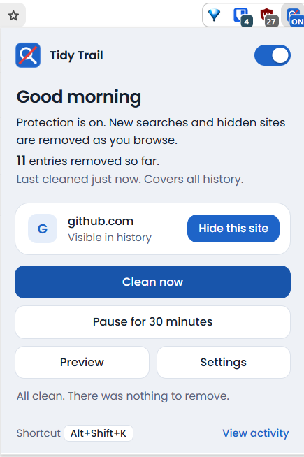
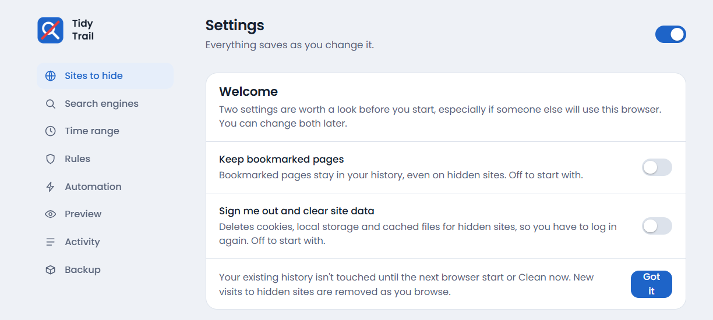
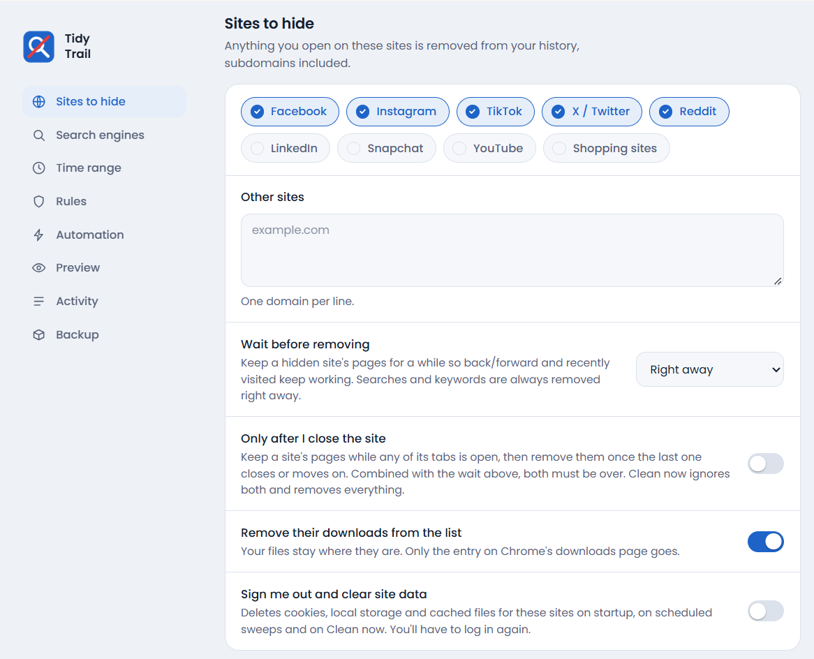
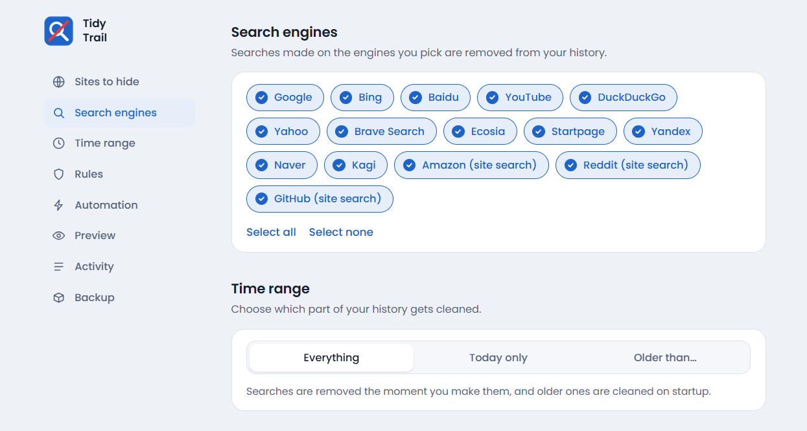
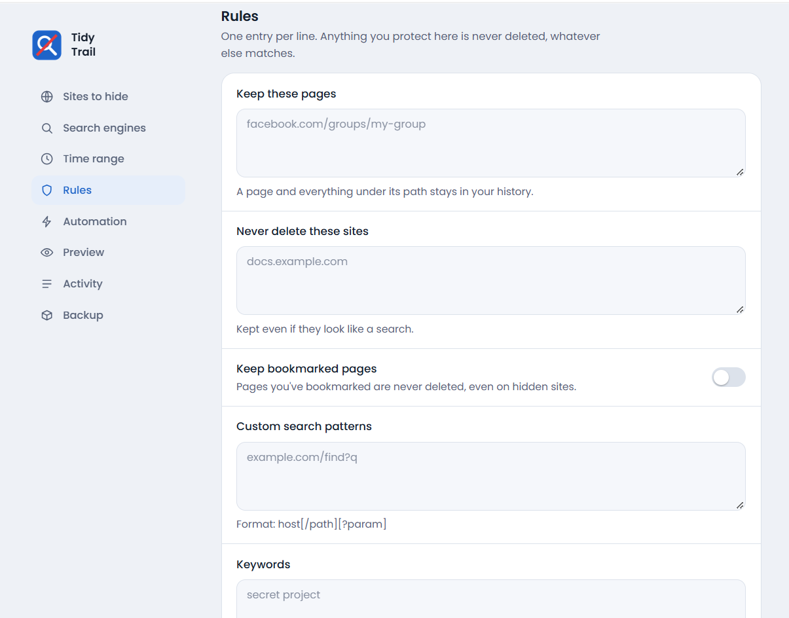
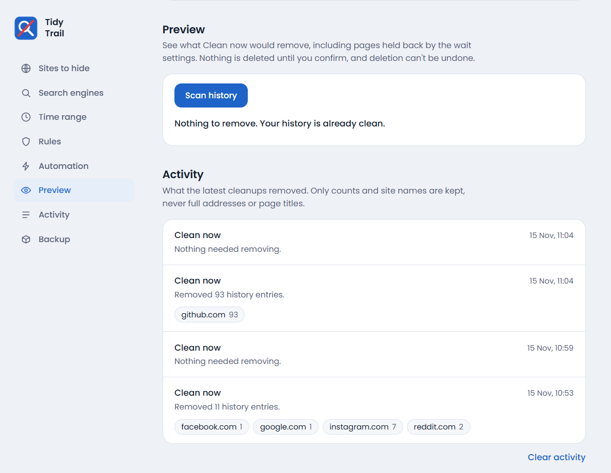

# Tidy Trail

A Chrome extension (Manifest V3) that stops your past searches from showing up in the address bar. It removes search queries, and the sites you choose, such as Facebook, Instagram and TikTok, from your history as you browse. It can remove them right away, after a delay, or only once you close the site's tabs.



*The kind of entry Tidy Trail exists to remove: a past search offered back to you as you type in the address bar.*

Works in Chrome, Edge and Brave (Chrome 102 or newer). There is no build step, no account, no server and no network access.


## Why Tidy Trail

When you type in Chrome's address bar, it suggests things you have searched for or visited before. The suggestions with a clock icon, like the one above, come from your browsing history. Type "in" and a search for "instagram" appears again, for you and for anyone using your screen.

Chrome only lets you remove these one at a time, with the × button on each suggestion. Tidy Trail does it automatically: every search on the engines you pick is removed from history as soon as you make it, so it never turns into a suggestion. The same applies to whole sites you choose to hide.

If a suggestion still lingers, turn on **Deep clean** in Settings → Automation. It also runs Chrome's own history clear right after each search is removed.

## Contents

- [Why Tidy Trail](#why-tidy-trail)
- [Screenshots](#screenshots)
- [Features](#features)
- [Install](#install)
- [Quick start](#quick-start)
- [Using the popup](#using-the-popup)
- [Settings reference](#settings-reference)
- [How matching works](#how-matching-works)
- [How and when cleanups run](#how-and-when-cleanups-run)
- [Permissions and privacy](#permissions-and-privacy)
- [Project structure](#project-structure)
- [Architecture notes](#architecture-notes)
- [Development](#development)
- [Changelog](#changelog)

## Screenshots

### Popup

Pause, preview, hide the current site and clean now, all in one place.



### Settings

**First-run welcome.** Explains the bookmark and site-data options before anything is cleaned.



**Sites to hide.** One-click presets, your own domains, the wait before removing, tab-close mode, and download and site-data options.



**Search engines and time range.** Pick which engines' searches are removed, and which part of history is cleaned.



**Rules.** Protect pages, sites and bookmarks, add custom search patterns, and remove entries by keyword.



**Preview and activity.** See what would be removed before deleting, and review what past cleanups removed. Only counts and site names are kept.



## Features

**What gets removed**

- **Searches** on 15 engines and site searches: Google, Bing, Baidu, YouTube, DuckDuckGo, Yahoo, Brave Search, Ecosia, Startpage, Yandex, Naver, Kagi, plus Amazon, Reddit and GitHub site search. Each can be switched off.
- **Whole sites**, subdomains included, through one-click presets or your own list of domains.
- **Keywords**: any history entry whose address or title contains a word you choose.
- **Custom search patterns** for engines or sites not on the list.
- **Downloads list entries** from hidden sites. The files stay on disk; only the entry on Chrome's downloads page goes.
- **Site data** (cookies, local storage, IndexedDB, cache, service workers) for hidden sites, optionally. This signs you out.

**When it is removed**

- Right away as you browse.
- After a wait of 15 minutes, 1 hour, 6 hours or 1 day, so back/forward and "recently visited" still work while you use a site.
- Only after you close the site, meaning its last open tab closes or navigates away. This can be combined with a wait.
- On browser startup, on a schedule (every hour, 6 hours or day), on demand with **Clean now**, or from a keyboard shortcut.

**Control and safety**

- **Pause for 30 minutes** from the popup, which turns itself back on.
- **Right-click menu**: "Hide this site" and "Stop hiding this site" on any page or on the toolbar icon.
- **Protection rules**: never delete chosen domains, keep chosen pages and their subpaths, keep bookmarked pages.
- **Preview** shows exactly what would be removed before anything is deleted.
- **Confirmation on large cleanups**: Clean now asks first when it would remove more than 200 entries (adjustable).
- **Time range**: everything, today only, or only entries older than N days.
- **Activity log** with counts and site names only, never full addresses or page titles.
- **Export and import** settings as JSON.
- **First-run welcome** that explains the bookmark and site-data options.

## Install

The extension is installed from source as an unpacked extension.

1. Download or clone this repository and unzip it if needed.
2. Open `chrome://extensions` (or `edge://extensions`, `brave://extensions`).
3. Turn on **Developer mode**.
4. Click **Load unpacked** and choose the project folder, the one containing `manifest.json`.
5. Optional: pin the extension to the toolbar.

To update from an older version, click **Reload** on the extension card, or remove the old copy and load the new folder.

On a fresh install the Settings page opens with a short welcome card. The first install does not clean your existing history. That happens at the next browser start or when you press **Clean now**.

## Quick start

1. Open **Settings** from the popup.
2. Under **Sites to hide**, switch on the sites you want hidden. Facebook, Instagram and TikTok are on by default; the other presets start off.
3. Under **Search engines**, keep the engines whose searches you want removed.
4. Click **Scan history** under **Preview** to see what would be removed, then delete if it looks right.

Everything in Settings saves as you change it.

## Using the popup

| Control | What it does |
| --- | --- |
| Toggle (top right) | Turns protection on or off. |
| Counter | Total entries removed so far, and when the last cleanup ran. |
| Site card | Shows the current site. **Hide this site** or **Stop hiding** switches it. Hiding a site also removes what is already in history for it, keeping recent pages if a wait or tab-close setting is on. |
| **Clean now** | Removes everything that matches your rules immediately, ignoring the wait and tab-close settings. Asks first above the large-cleanup limit. |
| **Pause for 30 minutes** | Stops all removal until the time shown. Becomes **Resume now** while paused. |
| **Preview** | Opens the Preview section of Settings. |
| **Settings** | Opens the full settings page. |
| Shortcut | The Clean now key combination. Default `Alt+Shift+K`. Change it at `chrome://extensions/shortcuts`. |

The toolbar badge shows `ON`, `OFF`, or `II` while paused. After a keyboard-shortcut cleanup it briefly shows the number removed, `✓` if nothing was removed, `?` if the cleanup was large enough to need a look first, or `!` on error.

**Right-click menu.** Right-click any web page, or the toolbar icon, and choose **Hide this site** or **Stop hiding this site**. The badge flashes the number of entries removed.

## Settings reference

### Sites to hide

| Setting | Default | Description |
| --- | --- | --- |
| Preset chips | Facebook, Instagram, TikTok on; the rest off | Facebook, Instagram, TikTok, X / Twitter (`x.com`, `twitter.com`), Reddit (`reddit.com`, `redd.it`), LinkedIn, Snapchat, YouTube (`youtube.com`, `youtu.be`), and a Shopping bundle (see `engines.js` for its domains). Hover a chip to see its domains. |
| Other sites | empty | One domain per line. Subdomains are included. |
| Wait before removing | Right away | Keep a hidden site's pages for 15 minutes, 1 hour, 6 hours or 1 day. |
| Only after I close the site | Off | Hold a site's pages while any of its tabs is open. With a wait set too, both must be over. |
| Remove their downloads from the list | On | Removes the downloads-page entry for files from hidden sites. Files are not deleted. |
| Sign me out and clear site data | Off | Deletes cookies, local storage, IndexedDB, cache storage and service workers for hidden sites on startup, scheduled sweeps and Clean now. Sites you have open are skipped when a wait or tab-close setting is on. |

Searches and keyword matches are never held back by the wait or tab-close settings. They are always removed immediately.

### Search engines

Chips for each supported engine, with **Select all** and **Select none**. A search is recognised by the engine's host, path and query parameter.

### Time range

- **Everything**: searches are removed as they happen, older ones at startup.
- **Today only**: only entries since midnight are cleaned.
- **Older than N days**: new entries are kept for N days and removed by a later sweep. Live deletion is off in this mode.

### Rules

All rules take one entry per line, and protection always wins over deletion.

| Rule | Format | Effect |
| --- | --- | --- |
| Keep these pages | `facebook.com/groups/my-group` | That page and everything under its path is never deleted. |
| Never delete these sites | `docs.example.com` | The domain and its subdomains are never deleted, even if they look like a search. |
| Keep bookmarked pages | toggle | Bookmarked URLs are never deleted, even on hidden sites. |
| Custom search patterns | `host[/path][?param]` | Treat matching URLs as searches, for example `example.com/find?q`. |
| Keywords | plain words | Remove any entry whose address or title contains one of them (case-insensitive). |

### Automation

| Setting | Default | Description |
| --- | --- | --- |
| Re-sweep history | Never | A periodic full cleanup while Chrome is open: every hour, 6 hours or day. |
| Clean now shortcut | `Alt+Shift+K` | Runs a full cleanup. If it would remove more than the large-cleanup limit, it opens Preview instead. |
| Ask before large cleanups | 200 | Clean now asks for confirmation above this many entries. `0` never asks. |
| Deep clean (experimental) | Off | After each live search removal, also runs Chrome's own history clear from about a second before the visit. Try it if searches still appear as address-bar suggestions. It removes all history from that moment, which is normally just the search page. |

### Preview, Activity and Backup

- **Preview** scans history and lists up to the 300 most recent entries Clean now would remove, including pages held back by wait settings. Deleting requires a confirmation.
- **Activity** shows the last 25 cleanups with counts and site names. Frequent background cleanups are merged into one entry per hour.
- **Backup** exports and imports settings as JSON. The removed-entries counter is not included. Imports are validated and unknown fields are ignored.

## How matching works

A history entry is removed when any of these is true, unless protection applies:

1. **Hidden site**: its host equals a hidden domain or is a subdomain of it. `facebook.com` matches `m.facebook.com` but not `notfacebook.com`.
2. **Search URL**: it matches an enabled engine or custom pattern, meaning the host matches, the path starts with one of the engine's search paths, and at least one query parameter is present and non-empty. Parameters are read from both the query string and the `#hash`, because Google sometimes uses the hash.
3. **Keyword**: its address (also URL-decoded) or title contains a keyword.

**Protection** is checked first and always wins: never-delete domains, kept pages, then bookmarks if enabled.

Only `http` and `https` URLs are ever considered.

## How and when cleanups run

| Trigger | Respects wait and tab-close settings? | Notes |
| --- | --- | --- |
| Live, on each visit | Yes, for hidden-site pages | Searches go immediately. A second delete runs 1.5 seconds later and again after 30 seconds, because Chrome can re-add an entry just after a visit. |
| Browser startup / install update | Yes | Skipped on a fresh install. |
| Scheduled sweep | Yes | Interval set in Settings. |
| Held-page check | Yes | Every 5 minutes while a wait or tab-close setting is on, and shortly after a tab closes or navigates. |
| Clean now (popup, Settings) | No | Removes everything that matches. |
| Keyboard shortcut | No | Opens Preview if the result is over the confirmation limit. |
| Hide this site (popup, right-click) | Yes | Removes what is already there, keeping recent pages if a wait is set. |

While paused or switched off, live deletion, startup, scheduled and held-page sweeps all stand still. Clean now still works when you ask for it. Pages visited during a pause are removed at the next startup, scheduled sweep or Clean now.

## Permissions and privacy

The extension makes no network requests, loads no remote code and sends nothing anywhere. All state is stored in the browser.

| Permission | Why it is needed |
| --- | --- |
| `history` | Search and delete history entries, and watch new visits. |
| `storage` | Save settings (`sync`), counters, log and pause time (`local`), and the retry queue (`session`). |
| `alarms` | Scheduled sweeps, the held-page check, retry after a failed delete, and ending a pause. |
| `browsingData` | Site-data clearing and the experimental deep clean. |
| `downloads` | Remove downloads-page entries for hidden sites. |
| `bookmarks` | Protect bookmarked pages. |
| `tabs` | Know which hidden sites have an open tab, and read the current page for the popup and right-click menu. |
| `contextMenus` | The right-click Hide / Stop hiding items. |

**Where data lives**

- `chrome.storage.sync`: your settings. These sync across your signed-in Chrome profiles.
- `chrome.storage.local`: removed-entries counter, last-clean time, activity log, pause time, first-run flag. These stay on this browser.
- `chrome.storage.session`: a short list of URLs queued for a second delete attempt. Held in memory only.

The activity log keeps counts and host names only, never full URLs or page titles.

## Project structure

```
tidy-trail/
├── manifest.json        Manifest V3: permissions, service worker, popup, options, shortcut
├── background.js        Service worker: deletion, sweeps, alarms, tabs, menus, messages
├── engines.js           Shared logic: engines, presets, defaults, matching, hide/unhide helpers
├── popup.html / popup.js    Toolbar popup
├── options.html / options.js    Settings page (also first-run welcome, preview, log, backup)
├── ui.css               Shared styles, light and dark
├── icons/               16, 32, 48, 128 px
├── docs/                README screenshots (not needed at runtime)
├── fonts/               Poppins (400, 500, 600, 700), bundled
├── Poppins-OFL-LICENSE.txt
└── README.md
```

## Architecture notes

- **`engines.js`** is shared by the service worker, popup and options page. It holds the engine and preset definitions, `DEFAULTS`, `getSettings()`, and the pure matching functions (`compileSettings`, `matchesItem`, `isSearchUrl`, `blockedName`, `isDue`, `hideSite`, `unhideSite`). Rules are compiled once per sweep rather than per URL.
- **Presets.** Each preset has a `domains` list. `off: true` makes it start switched off. `group: true` marks a bundle (Shopping): hiding one site from the popup adds only that domain, and "Stop hiding" on a bundled site adds it to the never-delete list.
- **The gate.** For wait and tab-close settings, a "gate" object (`delayMs`, `waitForTabClose`, and the set of hidden sites with an open tab) is built per sweep. `isDue(item, c, gate)` returns whether an item may go now. Manual cleanups pass no gate.
- **Scans** page through `chrome.history.search` in blocks of 5000. The held-page check searches once per hidden domain instead of walking the whole history, and full sweeps remain the safety net.
- **Counters and logs** are written through serialized promise chains so concurrent updates are not lost.
- **Service-worker lifetime.** State that must outlive the worker uses storage or alarms rather than variables. Alarms are re-synced on every startup.
- **Messages** from the popup and Settings page to the worker:
  - `{ type: "cleanNow", force?: boolean, checkLimit?: boolean }` returns `{ deleted, downloads, siteData }`, or `{ needsConfirm: true, count, limit }` when `checkLimit` is set and the cleanup is over the limit. `force: false` respects wait settings.
  - `{ type: "preview" }` returns `{ count, items }`.

## Development

There is no build step. Edit the files and reload.

1. Load the folder as an unpacked extension (see [Install](#install)).
2. After changing code, click **Reload** on the extension card. Reloading a Manifest V3 service worker is not needed beyond that.
3. Debug the worker: on the extension card, click **service worker** to open its DevTools. Debug the popup by right-clicking it and choosing **Inspect**. The Settings page opens in a normal tab and can be inspected as usual.
4. Inspect stored state in the worker's console, for example:

   ```js
   await chrome.storage.sync.get(null);
   await chrome.storage.local.get(null);
   ```

5. Pure functions in `engines.js` have no browser dependencies besides `getSettings()`, so they can be unit-tested in Node by importing the module and calling `compileSettings`, `matchesItem`, `isDue` and friends directly.

To add a search engine, add an entry to `ENGINES` in `engines.js` with a host matcher, search paths and query parameters. To add a preset, add an entry to `SITES`.


## Changelog

### 3.1

- Wait before removing (15 minutes to 1 day) and removal after the site's tabs close, usable together.
- Pause for 30 minutes from the popup.
- Right-click Hide this site and Stop hiding this site.
- New presets: X / Twitter, Reddit, LinkedIn, Snapchat, YouTube and Shopping sites, all off by default.
- Confirmation on Clean now above a configurable number of entries.
- First-run welcome explaining bookmark protection and site-data clearing.
- New permissions: `tabs`, `contextMenus`. Removed `activeTab`.

### 3.0

- Redesigned popup and settings page, activity log, preview, backup, scheduled sweeps, keep-these-pages and bookmark protection, keyword and custom-pattern rules, download-list cleanup, site-data clearing, and experimental deep clean.

The bundled Poppins font is © The Poppins Project Authors and is licensed under the [SIL Open Font License 1.1](Poppins-OFL-LICENSE.txt). 
